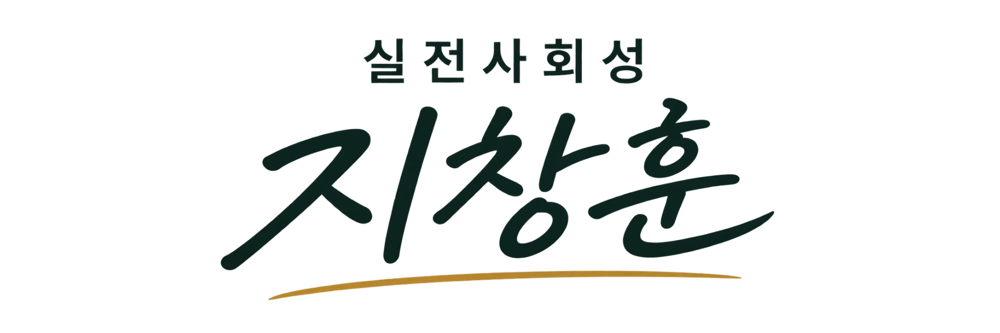

# 실전사회성 지창훈 — 브랜드 가이드 (영상용)

## 로고 구성
- 윗줄: **실전사회성** — 작고 단정한 고딕체, 자간 넓게 (전문 분야 표시)
- 메인: **지창훈** — 붓글씨 손글씨체, 크고 역동적 (사람 = 브랜드)
- 밑줄: 금색 붓 스트로크 (따뜻함·신뢰 포인트)
- 배경: 흰색 / 원본 2000×667 (3:1 가로형)

## 컬러
| 용도 | 색 | HEX |
|---|---|---|
| 메인 (글자) | 딥 그린 블랙 | `#0B221E` |
| 포인트 (밑줄) | 머스타드 골드 | `#B3842B` |
| 배경 | 화이트 | `#FFFFFF` |

## 영상 적용 규칙
- **엔딩 카드 (마지막 2초)**: 흰 배경 + 로고 중앙, 금색 밑줄이 왼→오 그려지는 모션
- **워터마크**: 우상단, 작게 `실전사회성 지창훈`, 투명도 70%
- **자막**: 흰 글씨 + `#0B221E` 반투명 박스 / 핵심 단어는 `#B3842B` 강조
- **릴스 세이프존**: 9:16 기준 상·하단 15%는 UI에 가려지므로 로고·자막 금지
- 로고 위에 사진을 겹치지 않는다 (흰 배경 유지)
